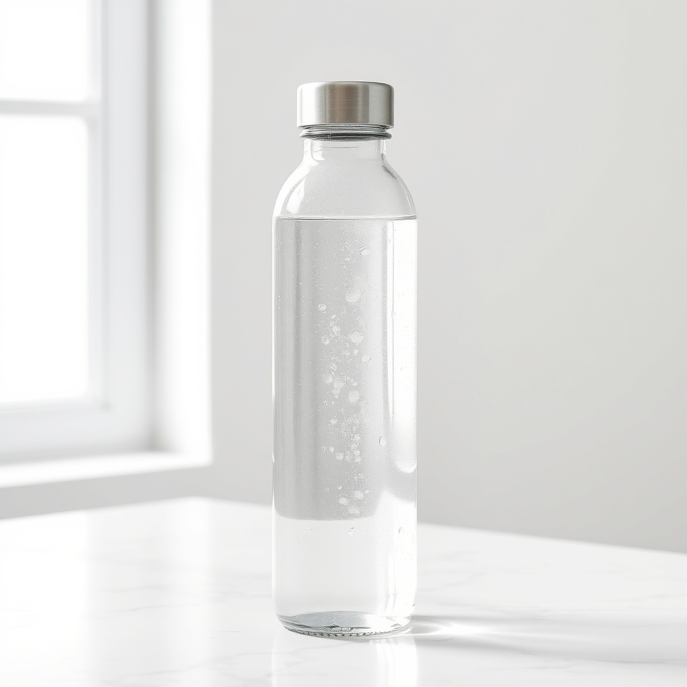

# Generar imágenes con Claude (gratis)

Añade a **Claude Code** (app de escritorio o terminal) la capacidad de crear imágenes a partir de un texto. Le pides «genera una imagen de una botella de agua» y te guarda un JPG en la carpeta en la que estás trabajando.

Usa **FLUX** a través de Cloudflare, que regala unas **170 imágenes al día**. No hace falta tarjeta.



## Qué necesitas

- Windows 10 u 11 con **Claude Code** instalado.
- Una **cuenta gratis de Cloudflare**.
- Node.js. Si no lo tienes, el instalador lo instala él solo.

## Instalación (unos 5 minutos)

### 1. Descarga este paquete

Arriba en esta página: botón verde **Code → Download ZIP**. Descomprímelo donde quieras (por ejemplo en el Escritorio).

### 2. Saca tus dos datos de Cloudflare

1. Crea una cuenta en <https://dash.cloudflare.com/sign-up> (o entra si ya tienes una).
2. En el menú de la izquierda, entra en **AI → Workers AI**.
3. Pulsa **Use REST API**. En esa página verás:
   - Tu **Account ID**, un código de 32 caracteres. Cópialo.
   - El botón **Create a Workers AI API Token**. Púlsalo, deja los permisos que vienen y pulsa **Create API Token**. Copia el token. Solo se enseña una vez.

> Si no encuentras esa página: el token se puede crear en **My Profile → API Tokens → Create Token → plantilla «Workers AI»**. El Account ID aparece en la página principal de tu cuenta, abajo a la derecha.

### 3. Ejecuta el instalador

Doble clic en **`INSTALAR.cmd`**. El instalador:

1. Comprueba Node.js y lo instala si falta.
2. Copia la skill `generar-imagen` a tu Claude (`%USERPROFILE%\.claude\skills\generar-imagen`).
3. Te pide el Account ID y el token. El token no se ve al pegarlo, y es normal. Se guardan en tu usuario de Windows, no en ningún archivo.
4. Hace una imagen de prueba en tu Escritorio y la abre.

Si Windows muestra un aviso azul de SmartScreen, pulsa **Más información → Ejecutar de todas formas**.

### 4. Reinicia Claude

Cierra Claude del todo y vuelve a abrirlo. Después pídele, por ejemplo:

- «Genera una imagen de una botella de agua sobre mármol, luz natural»
- «Hazme 3 versiones de un fondo abstracto en tonos verdes para un post»
- «Crea una ilustración plana de una taza de café»

## Límites

- Las imágenes son **cuadradas, de 1024×1024**.
- **El texto dentro de la imagen sale mal.** Pon los textos aparte.
- La calidad es buena para bocetos, fondos, ideas y mockups. **No las uses como si fueran fotos reales** de un producto o cliente.
- Cuota gratis: unas 170 imágenes al día. Se renueva a medianoche UTC (1:00 o 2:00 en España).

## Si algo falla

| Mensaje | Solución |
|---|---|
| `No encuentro las claves de Cloudflare` | Doble clic en **`Guardar claves Cloudflare.cmd`** y reinicia Claude. |
| `Cloudflare rechaza las claves (401/403)` | El token está mal copiado o no tiene el permiso «Workers AI». Crea otro y guárdalo con `Guardar claves Cloudflare.cmd`. |
| `cuota gratis de hoy` | Has llegado al límite diario. Espera al día siguiente. |
| Claude no usa la skill | Comprueba que reiniciaste Claude. Si sigue sin usarla, pídeselo directamente: «usa la skill generar-imagen». |

## Mac o Linux (manual)

```bash
mkdir -p ~/.claude/skills
cp -R skills/generar-imagen ~/.claude/skills/
echo 'export CLOUDFLARE_ACCOUNT_ID="tu-account-id"' >> ~/.zshrc
echo 'export CLOUDFLARE_API_TOKEN="tu-token"' >> ~/.zshrc
```

Necesitas Node.js 18 o posterior. Reinicia la terminal y Claude.

## Qué hay dentro

- `skills/generar-imagen/SKILL.md`: las instrucciones para Claude (cuándo usarla y cómo escribir buenos prompts).
- `skills/generar-imagen/generar.mjs`: el script que llama a Cloudflare. No necesita instalar paquetes.
- `INSTALAR.cmd` y `instalar.ps1`: el instalador para Windows.
- `Guardar claves Cloudflare.cmd` y `guardar-claves.ps1`: guardan o cambian las claves.

Este paquete **no contiene ninguna clave**. Cada persona usa su propia cuenta de Cloudflare.
